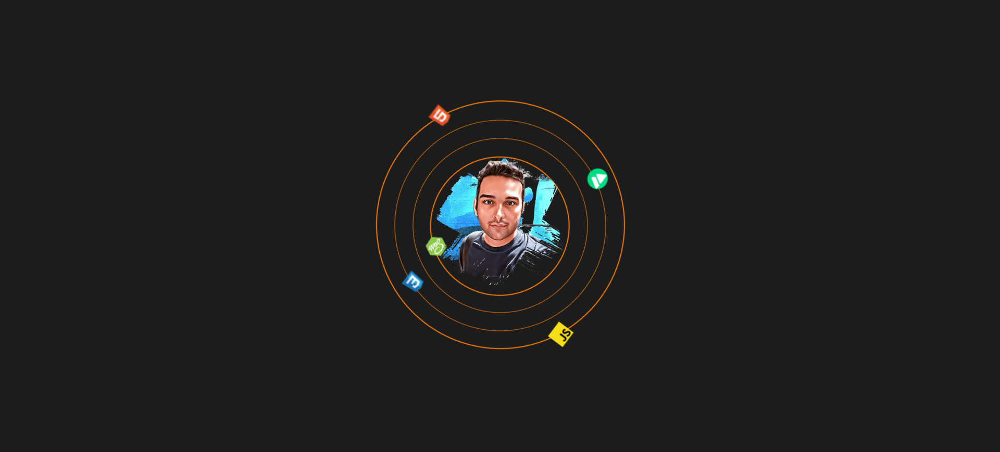

# Circular Orbit Animation

A lightweight, CSS-only animation that arranges web technology icons around a portrait. The rings rotate continuously and pause when you hover over the animation.

## Preview

The technology icons orbit the portrait on animated rings. Hover over the animation to pause the rotation.

## Run locally

Open `index.html` in a modern browser. No build step, JavaScript, or package installation is required. The images are included in the repository, so the project also works without an internet connection.

## Built with

- HTML
- CSS animations and custom properties

## Project files

| File | Purpose |
| --- | --- |
| `index.html` | Animation markup and image elements |
| `main.css` | Layout, orbit styling, and rotation animation |
| `imgs/` | Local portrait and technology icon images |
| `imgs/preview.png` | Screenshot shown above |

## Customize

You can adjust the animation in `main.css`:

- Change the orbit speed by editing the `15s` duration on `.circle`.
- Change the ring spacing with the `--circlesBigger` custom property.
- Change icon size with `--icon`.
- Replace the image paths in `index.html` to use your own portrait and icons. Keep image files in `imgs/` or update the paths to match their location.

## License

No license is currently specified. Add a license file before redistributing or reusing the project if you want to grant others explicit permission.
